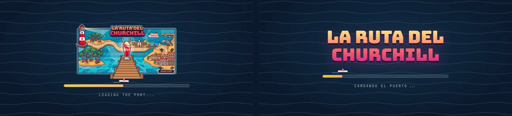
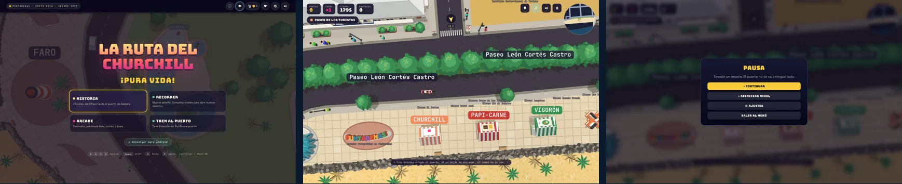
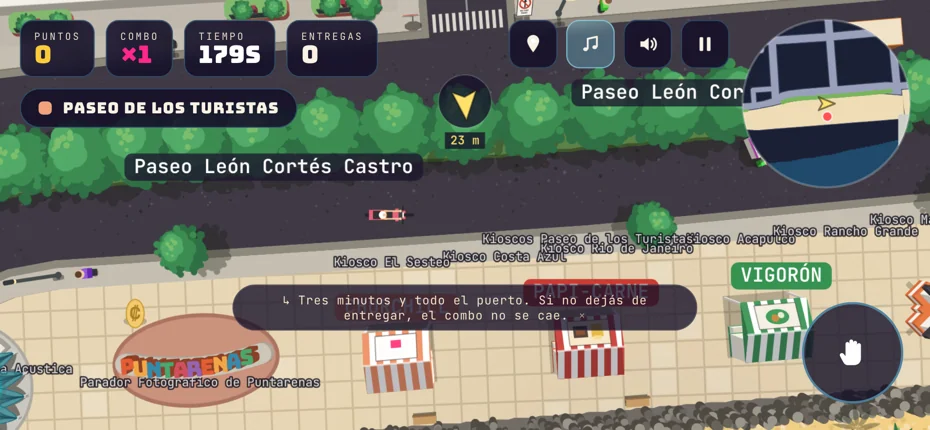
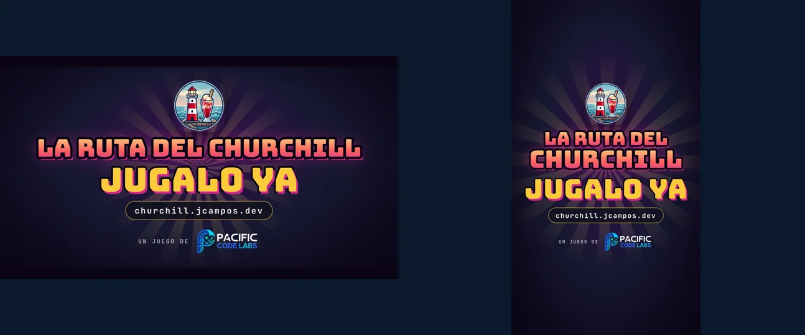
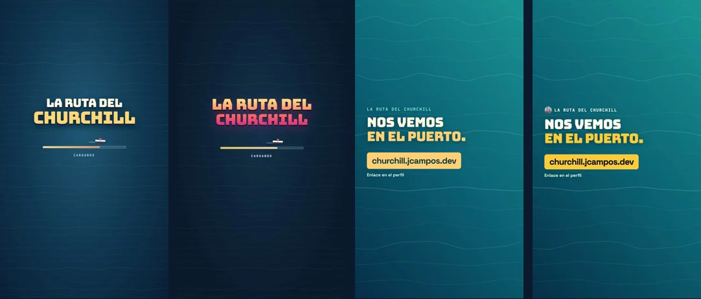
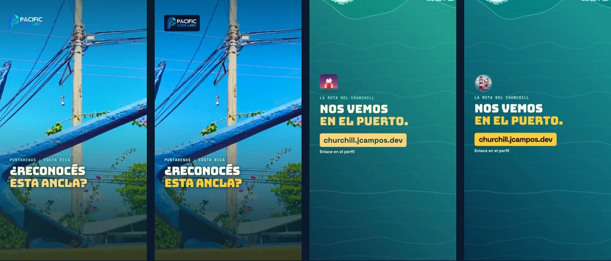
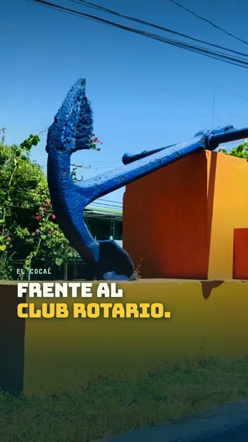
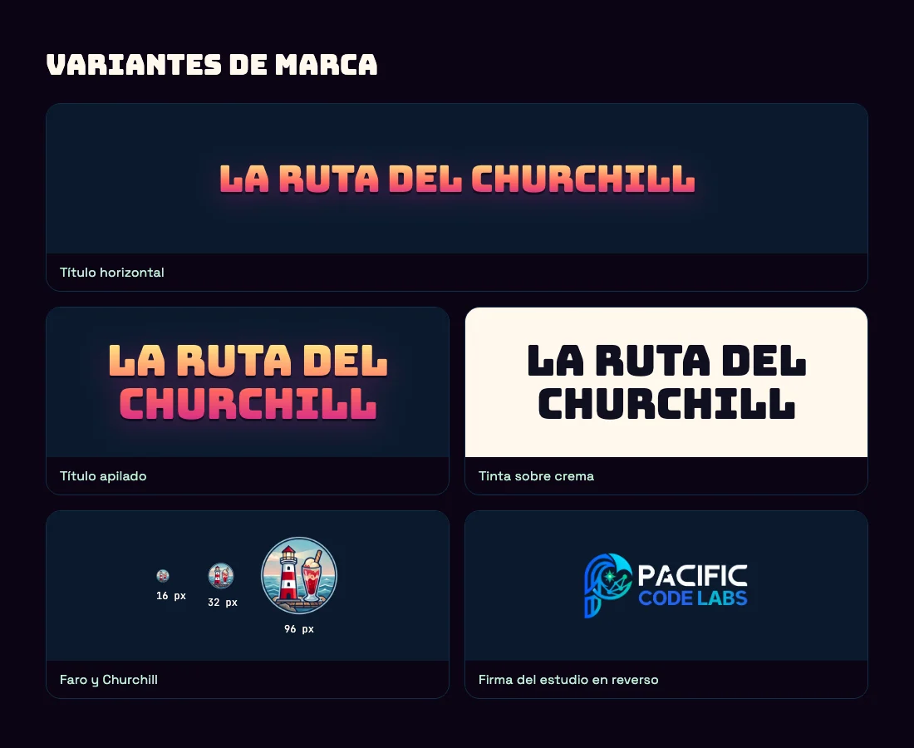

# Pruebas visuales · marca v1

## Juego

**Carga en horizontal.** La captura anterior está a la izquierda. A la derecha, el título oficial en WebKit con viewport de iPhone. El ferry y la barra se midieron en el mismo cuadro en Chromium y WebKit. El desfase medido fue inferior a 1 px CSS.

**Interfaz.** Menú, partida de Arcade en el Paseo de los Turistas y pantalla de pausa.

**Controles táctiles.** Partida de Arcade en Chromium con perfil de teléfono y viewport de 844 × 390.

## Publicaciones

**Tráiler.** Cierres horizontal y vertical a los 36 s, capturados desde HyperFrames.

**Reel 03.** Comparación de la carga y el cierre de la edición de 1 112 fotogramas. Cada bloque muestra la versión archivada seguida del render con la marca compartida.

**Documentando El Cocal.** Antes y después de la firma del estudio y el cierre. El montaje conserva las tomas, la música y el oleaje. El rótulo del ancla se actualizó a «Frente al Club Rotario».

## Variantes

Lámina generada con los WOFF2 de la biblioteca y el PNG vigente. Incluye el título apilado, el de una línea, la tinta sobre crema y el emblema en tamaños de 16, 32 y 96 px.

## Verificación técnica

- `pnpm build`, verificación de marca, inventario y pruebas focalizadas de tema, pantallas, idiomas e inventario.
- El smoke de conducción movió el carro 416 px en 2 s y registró 288 de velocidad máxima, sin errores de página. El smoke de pantallas recorrió 19 estados. La prueba de orientación cubrió rotación y WebViews de Facebook e Instagram por emulación.
- La carga se revisó a 1440 × 900 y 640 × 340 en Chromium y a 844 × 390 en WebKit. En movimiento reducido se mantuvo el progreso sincronizado y el título apareció sin animación.
- La entrada JS principal pasó de 1 442,84 a aproximadamente 1 372 kB gzip al retirar el WebP de carga incrustado. La hoja principal creció menos de 1 kB gzip. El snapshot del mundo confirmó que sus 1 001 archivos son idénticos.
- El Reel 03 y El Cocal se renderizaron completos en Remotion a 1080 × 1920 y 30 fps, con 1 112 y 1 080 cuadros respectivamente y audio AAC. Los siete respaldos del tráiler pasaron la verificación de tamaño y SHA-256.
- La suite completa ejecutó 604 pruebas. Reproduje en el commit de partida el fallo de coordenadas del cliente `c5` de `test_content`. HyperFrames detectó dos superposiciones por corte en los mismos cuadros del tráiler original y del actualizado.
