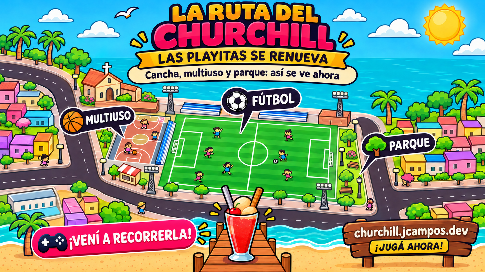
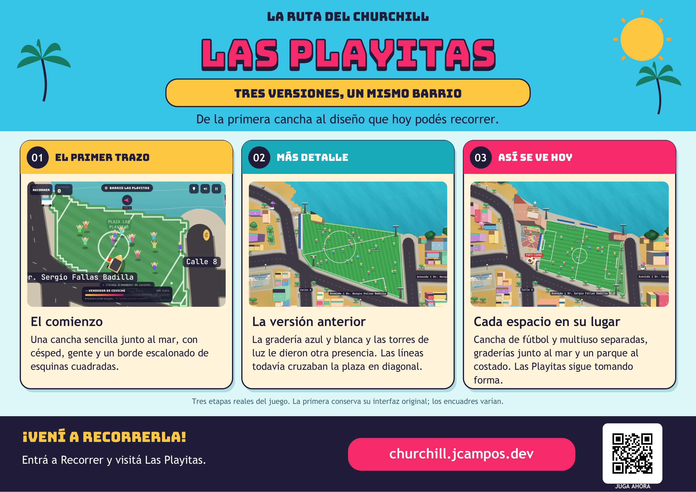

# Las Playitas: tres versiones, un mismo barrio

Estado: preparada, sin publicar.

## Texto (Facebook e Instagram)

```text
Las Playitas ha cambiado un montón ⚽🏀🌳

De aquella cancha con bordes cuadrados a una plaza con cada espacio en su lugar:
fútbol, multiuso, graderías junto al mar y un parque al costado.

El brochure reúne tres etapas reales de su evolución en La Ruta del Churchill.

¡Vení a recorrerla! 👉 https://churchill.jcampos.dev (enlace en el perfil)

#LaRutaDelChurchill #LasPlayitas #Puntarenas
```

## Piezas listas

- [Afiche ilustrado, sin cara en el churchill](img/2026-11-12-las-playitas/publicacion-las-playitas.png).
- [Brochure comparativo en PNG](img/2026-11-12-las-playitas/brochure-tres-versiones.png), 3000 × 2122 px.
- [Brochure en PDF](../../output/pdf/las-playitas-tres-versiones.pdf), una página A4 horizontal, con enlace y QR al juego.





## Procedencia de las tres versiones

| Etapa | Fuente | Qué muestra |
|---|---|---|
| 01 · El primer trazo | Imagen original adjunta por el usuario, conservada sin modificar en `img/2026-11-12-las-playitas/01-primer-trazo.webp`. | Cancha simple y borde escalonado con esquinas cuadradas. |
| 02 · Más detalle | Captura real de `a65b768a48248a3b618e1d6c0ff406e3529c5e43`, anterior al rediseño `e63ebb24`. | Gradería azul y blanca, torres de luz y marcas en diagonal. |
| 03 · Así se ve hoy | Captura real del juego en `a99d8078`, estado del repositorio al preparar estas piezas. | Fútbol y multiuso separados, graderías y parque lateral. |

Las versiones 02 y 03 se ejecutaron en el navegador por separado, con la misma
cámara (1600 × 1000 CSS px, escala de captura 1,5, centro 31615/18400 y zoom 2,15).
Se ocultó la interfaz y se usó una vista desbloqueada y soleada. No se alteró la
geometría del mundo. Ambas capturas terminaron sin errores de página.

La primera conserva la interfaz y el encuadre del adjunto. En el brochure las
imágenes se enmarcan con un recorte leve para llenar sus tarjetas; los archivos
fuente están completos.

El afiche es una **ilustración promocional**, basada en la distribución de la
captura actual y en el afiche de referencia adjunto; no es una captura del juego.
Se creó con el generador de imágenes integrado y se editó a petición del usuario
para quitar los ojos y la sonrisa del churchill.

- [Prompt inicial del afiche](img/2026-11-12-las-playitas/prompt-afiche.txt).
- [Prompt de edición sin cara](img/2026-11-12-las-playitas/prompt-edicion-sin-cara.txt).
- [Fuente del brochure](source/2026-11-12-las-playitas/build_brochure.py) (Python: reportlab, Pillow y fonttools; fuentes del juego y Trebuchet MS de macOS).
- [Captura de las dos versiones](source/2026-11-12-las-playitas/capture.mjs) (ejecutar desde la raíz; servidores Vite en 8746 para `a65b768a` y en 8745 para el juego actual, con cachés separadas).

La pieza y el brochure se revisaron visualmente. El PDF conserva texto
seleccionable y el enlace al juego. Se verificó que el QR decodifica a
`https://churchill.jcampos.dev`.
